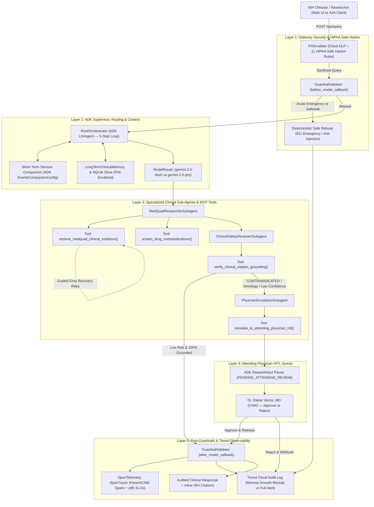
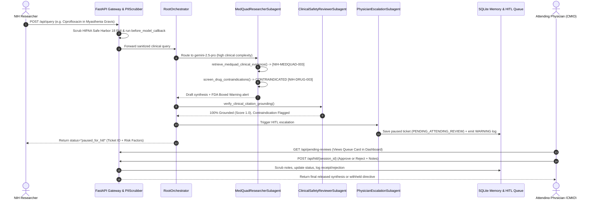
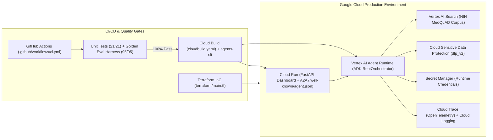

# NIH MedQuAD Clinical Assistant — System Architecture & Design Flowcharts

This document details the end-to-end architecture, multi-agent control flow, Human-in-the-Loop (HITL) clinical governance sequence, and Google Cloud infrastructure topology for the **NIH MedQuAD Clinical Assistant**.

---

## 1. End-to-End 5-Step Clinical Architecture & Multi-Agent Flow

---

## 2. Attending Physician Human-in-the-Loop (HITL) Sequence Diagram

---

## 3. Production Google Cloud & CI/CD Architecture

